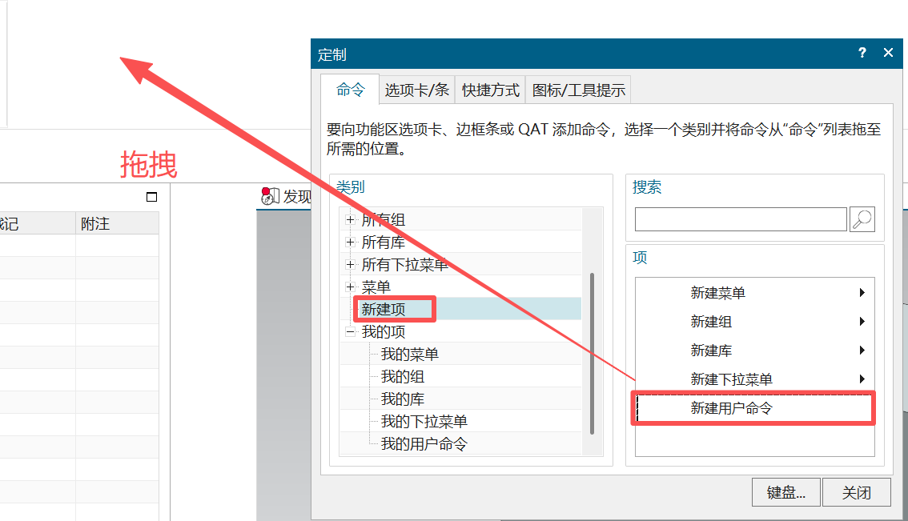
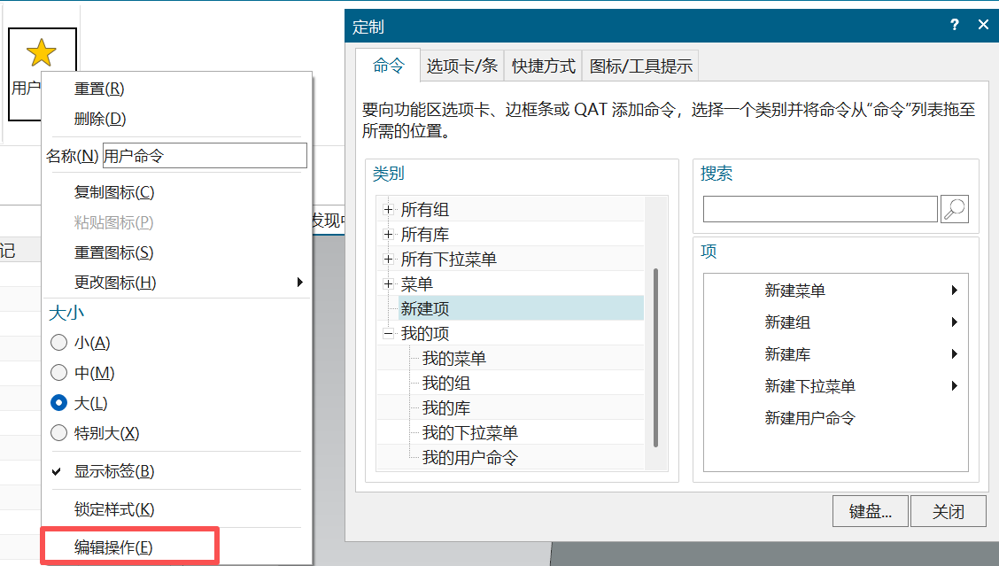
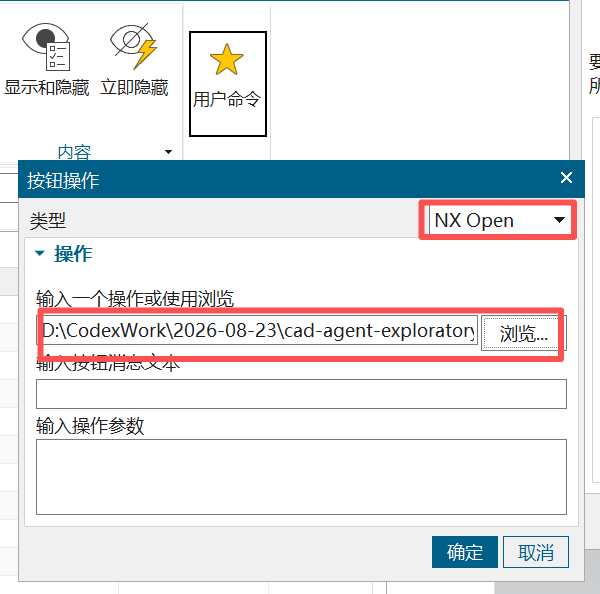
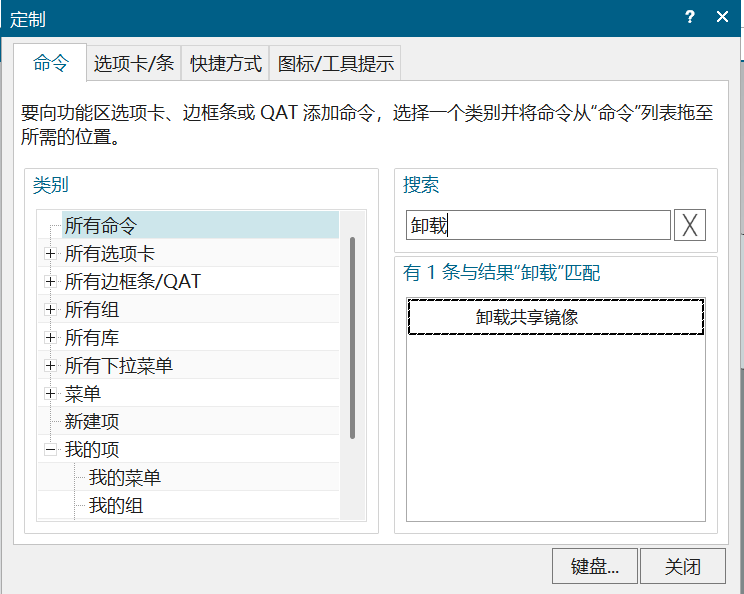
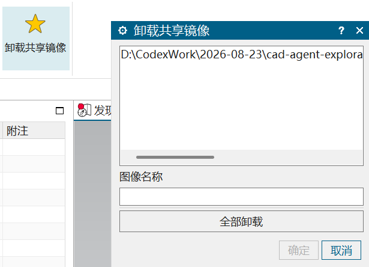

# 在 NX 中启动和卸载插件

先运行 `build.ps1 -NxRoot "你的 NX 安装目录"` 编译 DLL，然后在 NX 中按下面三步添加按钮。截图中的路径仅为示例，请选择自己电脑上编译得到的 DLL。

## 1. 新建用户命令

打开“定制”窗口，在“命令”页选择“新建项”，把右侧的“新建用户命令”拖到需要的位置。

## 2. 编辑操作

保持“定制”窗口打开，右键刚添加的按钮，选择“编辑操作”。

## 3. 选择 DLL

将类型设为 **NX Open**，点击“浏览”选择编译得到的 DLL。“操作参数”留空，点击“确定”，关闭“定制”窗口。

以后打开 NX 后，点击这个按钮启动服务即可。信息窗口显示 `NX Raw MCP: Listening on http://127.0.0.1:20790/` 表示启动成功。按钮设置本身不代表 NX 启动时自动运行服务。

## 卸载插件

打开“定制”窗口，在“所有命令”中搜索“卸载”，将“卸载共享镜像”拖到需要的位置。

关闭“定制”窗口，点击“卸载共享镜像”按钮。在列表中选择要卸载的 DLL，点击“确定”；也可以点击“全部卸载”。

需要重新使用时，再点击之前设置的启动按钮加载插件。
